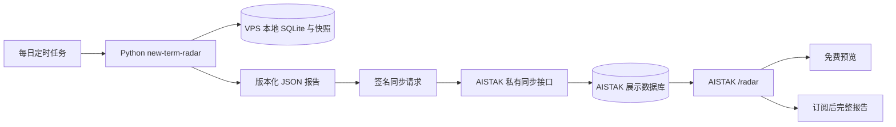

# AISTAK Opportunity Radar 可行性报告

**结论：可行，建议将 `new-term-radar` 定位为 AISTAK 的内部采集端，并以 AISTAK 的 `/radar` 模块对外提供付费报告。现阶段不建议新建独立品牌或独立域名。**

## 1. 战略建议

### 以 AISTAK 为统一产品入口

建议将 AISTAK 从“AI 工具目录”升级为 **AI Market Intelligence Platform（AI 行业情报平台）**，形成两条相互补充的产品线：

| 模块 | 用户要解决的问题 | 核心价值 |
| --- | --- | --- |
| Site Growth Intelligence | 哪些 AI 网站正在增长、值得关注？ | 发现已被市场验证的产品与增长案例 |
| Opportunity Radar | 哪些新需求或细分机会值得做？ | 从早期信号中发现潜在产品机会 |

`new-term-radar` 对应第二条产品线。它不应单独成为一个通用关键词工具，而应成为 AISTAK 情报能力的一部分：用户先发现 AI 工具和赛道，再判断赛道增长与新需求，最后购买报告、监控或深度分析。

### 域名决策

建议首期使用：

```text
aistak.com/radar
aistak.com/radar/[report-or-opportunity-id]
```

不建议现在启用独立域名。独立域名意味着重新建立品牌、SEO、账户、支付、内容与获客渠道，会分散当前现金流验证的精力。

若以后需要技术隔离，可使用 `radar.aistak.com`，但仍应使用 AISTAK 品牌、用户体系与支付体系；这不是一个新的独立产品。

## 2. 当前项目评估

### 已具备的能力

该项目已经是一个可按日运行的 Python 情报采集器：

- `python -m radar daily` 可生成 Markdown 日报与 JSON 结构化输出。
- 本地 SQLite 会保存候选词的发现时间、信号来源、名称评分、复盘状态与趋势复盘结果。
- 可综合 X、Hugging Face、GitHub 爆发项目、AI 工具站 sitemap、新站、Reddit 求助、Google Trends、搜索量、搜索竞争与 Search Console 等信号。
- 有 14 天后的趋势复盘机制，可以持续评估每类信号的命中率和提前量。
- 代码中已有失败降级逻辑：单个数据源失败时，报告仍会产出并标明缺失来源。

因此，将其作为每日“机会发现”采集端是可行的，而且没有必要重写为 TypeScript。

### 当前边界

项目并不是完整的网站增长情报系统：

- `new_sites` 能发现新注册、已获得一定排名的站点，但不能提供可靠的全量流量、增长曲线或用户地域分析。
- 本地 `state/radar.db` 是采集状态库，主要存储线索摘要；它不是面向付费用户查询的完整产品数据库。
- `keywords` 与 `pains` 等命令会触发外部服务调用，存在成本、耗时与稳定性边界，不适合第一期做成用户点击即执行的实时功能。

因此，AISTAK 可以先上线 Opportunity Radar；Site Growth Intelligence 应当作为另一条数据管线逐步建设，而不是错误地承诺由本项目单独完成。

## 3. 推荐架构



### 采集端

- 在 VPS 上保留原有 Python 运行环境，每天执行一次。
- 保留本地 SQLite、sitemap 快照和历史文件，因为这些数据用于新旧差分和 14 天复盘。
- 不建议把长耗时、慢速防风控、依赖本地快照的任务迁到 Cloudflare Worker。

### 数据同步与展示端

- 每日采集成功后，由 VPS **主动推送**一份版本化 JSON 报告到 AISTAK。
- 同步接口应使用共享密钥或 HMAC 签名、运行批次 ID 去重，以及采集时间/状态记录。
- 展示端读取 AISTAK 自己的数据库，而不是让用户请求实时跨公网读取 VPS 或连接其 SQLite。
- 首期可使用 Cloudflare D1 存储报告批次、机会、关键词、信号摘要、评分和历史快照；当前数据规模下无需预先引入复杂的 PostgreSQL 集群。

## 4. 产品与付费策略

首期应销售“经过筛选和解释的机会判断”，而不是销售原始爬取数据。

| 层级 | 建议内容 | 目的 |
| --- | --- | --- |
| Free | 当日少量机会预览、报告发布日期、方法说明 | SEO 获客与订阅转化 |
| Pro，建议测试 $19/月 | 完整机会报告、关键词规模与趋势、竞争判断、历史报告 | 验证订阅需求 |
| Studio，建议测试 $49/月 | 监控列表、深度机会分析、周期性研究报告 | 提高客单价与留存 |
| 单篇报告，建议测试 $5.9 起 | 单一赛道或关键词机会报告 | 验证即时付费意愿 |

第一期建议只做“每日/每周报告 + 历史报告库”。用户自定义实时分析、监控提醒、MVP Action Pack 和 API 均应在有真实付费用户后再扩展。

## 5. 数据使用与合规边界

必须把数据来源分为“可展示的推导结论”和“仅供内部研究的原始信号”。

- TrustMRR：项目说明已明确其 API 条款禁止公开转载数据和以此建立公开 SEO 页面。不要展示原始收入榜或收入明细；仅将其用作内部机会评分信号。
- Reddit、YouTube 评论：保留原始链接、有限引文或摘要，不批量转载帖子和评论内容。
- 搜索量、趋势、关键词难度、流量等：统一标记为第三方估算或趋势信号，不能描述为网站真实 GA4、Search Console 或精确市场规模。
- 每份报告应保留来源类别、采集日期、计算时间和免责声明，确保结论可解释、可回溯。

## 6. 建议的发布顺序

1. 配置 VPS 每日运行并连续积累至少 14 天历史数据。
2. 建立“采集报告 → AISTAK 数据库”的单向同步，不暴露 VPS 数据库。
3. 在 AISTAK 上发布 `/radar` 免费预览页与付费完整报告页。
4. 用单篇深度报告与 Pro 订阅测试用户的付款意愿。
5. 根据真实转化数据决定是否扩展监控、定制分析和 Studio 套餐。
6. 与此同时，独立建设 Site Growth Intelligence 的站点增长数据源；不要将其与雷达采集器混为同一能力。

## 7. 成功标准与主要风险

### 首期成功标准

- 每日任务连续 14 天稳定运行，且每次均记录报告批次与采集状态。
- 付费用户可访问完整报告，免费用户只能读取预览字段。
- 报告中的机会均可显示采集日期、来源类别和“估算/趋势信号”说明。
- 能获得首批单篇报告购买或 Pro 订阅，以验证市场是否愿意为“机会判断”付费。

### 主要风险

- 第三方 API 的价格、限流或可用性会影响信号完整性；产品页面必须明确展示数据状态，且不要依赖单一来源作为结论依据。
- 新词和趋势信号具有噪声，不能承诺“发现即赚钱”；应销售研究效率和决策辅助，而非保证商业结果。
- 若公开展示未经许可的原始收入、评论或第三方数据，可能触发来源条款风险；首期应以归纳结论和链接证据为主。

## 最终建议

以 AISTAK 为唯一对外品牌，用该项目在 VPS 上每天生成机会情报，并将经过筛选、合规处理和结构化存储后的报告同步到 AISTAK 的 `/radar`。先验证报告订阅和单篇报告付费，再投入自动监控、定制洞察与完整 Site Growth Intelligence。

这样可以最大化复用 AISTAK 既有的目录、SEO、用户和商业化基础，同时避免在独立产品、全量重写和复杂实时功能上过早投入。
