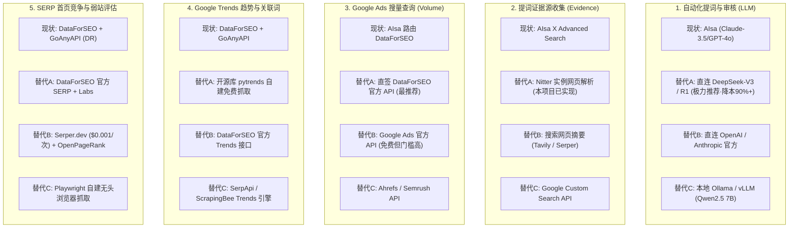

# new-term-radar 数据源与核心能力全景替代方案

> 本文针对 `new-term-radar` 系统中依赖的外部中转服务商（如 AIsa、GoAnyAPI 等）梳理了详细的**模块化技术替代方案**。旨在帮助开发者在面临**降低成本、摆脱单一代理依赖、提升系统稳定性与自主可控性**时，能够有清晰的技术路径与落地参考。

---

## 一、 系统现状与依赖痛点分析

当前系统中的关键能力高度聚合在少数中转平台：
- **`AISA_API_KEY`**：承担了 **大模型提词与打分**、**X 推文高级搜索**、**Google Ads 官方月搜量**、**Google Trends 全球趋势**、**SERP 首页竞争与 KD 难度** 五大核心任务；
- **`GOANYAPI_API_KEY`**：承担了 **Google Trends 关联词挖掘**、**单国（US）日级结算趋势**、**域名权重（DR）评估**、**竞品在投广告与建页数（intitle）监测**；
- **核心痛点**：
  1. **中转溢价**：聚合商在底层服务（如 DataForSEO、Claude 等）之上叠加了服务成本；
  2. **单点故障风险**：一旦聚合路由网关出现抖动或限流，多项信号同时受阻；
  3. **生态可替代性高**：其底层的 Google Ads、Google Trends、LLM 以及 SERP 数据，市面上均有成熟的官方或第三方直连平替。

---

## 二、 核心能力模块替代方案详解



---

### 模块 1：自动化提词与相关性审核（LLM）

* **涉及代码**：[`radar/usecases.py:161-243`](file:///Users/wenhao/fuwenhao/temp/demo-radar/new-term-radar/radar/usecases.py#L161-L243)、[`radar/judge.py`](file:///Users/wenhao/fuwenhao/temp/demo-radar/new-term-radar/radar/judge.py)
* **业务逻辑**：根据推文讨论和 README 提取 2~4 词通用工具/任务词（如 `SynthID` -> `ai image detector`），并二次打分（0.0~1.0）去除泛词和噪音。

#### 替代方案对比：

| 方案 | 接口地址与认证 | 核心优势 | 潜在短板 | 估算成本 | 推荐指数 |
| :--- | :--- | :--- | :--- | :--- | :--- |
| **方案 A：直连 DeepSeek 官方 API** | `https://api.deepseek.com/v1/chat/completions`<br>Header: `Authorization: Bearer <DEEPSEEK_KEY>` | 1. 提词理解力极强，完全胜任中文与英文提词；<br>2. 接口 100% 兼容 OpenAI 协议，代码仅需改两行；<br>3. 极其稳定便宜。 | 极少数高峰期时延可能波动。 | 输入 ¥1/M tokens<br>输出 ¥2/M tokens<br>*(几乎免费)* | ⭐⭐⭐⭐⭐<br>**(首选推荐)** |
| **方案 B：直连 OpenAI / Anthropic 官方** | `https://api.openai.com/v1` (`gpt-4o-mini`)<br>`https://api.anthropic.com/v1` (`claude-3-5-haiku`) | 国际顶级模型能力，输出极其格式化。 | 需海外信用卡支付，国内直连需要代理。 | ~$0.15 ~ $0.80 / M tokens | ⭐⭐⭐⭐ |
| **方案 C：本地 Ollama / vLLM 私有化部署** | 本地 `http://localhost:11434/v1`<br>模型: `qwen2.5:7b` 或 `llama3.1:8b` | 零 API 费用，无网络波动，完全离线运行，数据绝不泄露。 | 本地需具备 GPU（如 Mac M 系列芯片或显卡），并发速度受本地硬件限制。 | **$0** (消耗本地算力) | ⭐⭐⭐ |

#### 代码改造建议（以接入 DeepSeek 为例）：
在 [`radar/aisa.py`](file:///Users/wenhao/fuwenhao/temp/demo-radar/new-term-radar/radar/aisa.py#L23) 中，将 ChatCompletion 端点配置解耦为支持通用环境变量：
```python
# 改造前
CHAT = os.environ.get("AISA_API_BASE_URL", "https://api.aisa.one") + "/v1/chat/completions"

# 改造后：优先读取 LLM 独立配置，否则回退到 AIsa
LLM_BASE_URL = os.environ.get("LLM_BASE_URL") or os.environ.get("OPENAI_BASE_URL") or "https://api.deepseek.com"
LLM_API_KEY = os.environ.get("LLM_API_KEY") or os.environ.get("OPENAI_API_KEY") or key()
```

---

### 模块 2：提词证据源收集（Evidence Gathering）

* **涉及代码**：[`radar/usecases.py:115-142`](file:///Users/wenhao/fuwenhao/temp/demo-radar/new-term-radar/radar/usecases.py#L115-L142)
* **业务逻辑**：检索 X 平台关于新词的高赞讨论或开源项目 README，作为大模型理解技术意图的上下文输入。

#### 替代方案对比：

| 方案 | 技术实现方式 | 优势 | 适用场景 |
| :--- | :--- | :--- | :--- |
| **方案 A：Nitter 实例抓取 (已实现)** | 请求 `https://nitter.wenhaofree.com/search?f=tweets&q={name}` 提取高赞推文 | 免费、无第三方依赖、无需配置官方 API Key。 | 已自建或拥有稳定的 Nitter 实例。 |
| **方案 B：AI 搜索引擎 API (Tavily / Serper)** | 调用 `https://api.tavily.com/search`，参数 `{"query": "what is {name} tool", "search_depth": "basic"}` | 1. 比单抓推文信息更丰富（覆盖博客、官网、评测）；<br>2. 提词质量通常比仅靠推文更精准；<br>3. 每月有数千次免费额度。 | 想要更全面的全网证据链。 |
| **方案 C：Google Custom Search API (CSE)** | 官方提供的定制搜索引擎 API (`Programmable Search Engine`) | 每天 100 次免费查询，官方正规渠道，完全稳定。 | 日常小批量新词追踪。 |

---

### 模块 3：Google 官方搜索量查询（Search Volume）

* **涉及代码**：[`radar/usecases.py:269-281`](file:///Users/wenhao/fuwenhao/temp/demo-radar/new-term-radar/radar/usecases.py#L269-L281)
* **业务逻辑**：调用 Google Ads Keyword Planner 官方接口，批量查询候选词的过去 12 个月平均搜索量（`search_volume`）。

#### 替代方案对比：

| 方案 | 接入方式 | 计费与成本 | 评估分析 |
| :--- | :--- | :--- | :--- |
| **方案 A：直接开通 DataForSEO 官方账号 (强烈推荐)** | 注册 [DataForSEO.com](https://dataforseo.com/)，调用 `POST https://api.dataforseo.com/v3/keywords_data/google_ads/search_volume/live` | 充值最低 $50，按次计费：每次批量查询 700~1000 个词仅约 **$0.05 ~ $0.075** | **最佳平替**：AIsa 底层调用的正是 DataForSEO，直接对接官方无需修改返回数据解析逻辑，成本更低，省去中间商赚差价。 |
| **方案 B：Google Ads 官方 API 直连** | 申请 Google Cloud 开发者控制台，配置 OAuth 客户端并申请 Production Developer Token，调用 `GenerateKeywordHistoricalMetrics` | **免费** (Google 官方不收费) | **门槛极高**：申请审核周期长（需证明企业资质）；且若绑定的 Google Ads 账户没有实际广告消耗，Google **只返回宽泛范围区间（如 1K~10K）**，无法获得精确数值。 |
| **方案 C：SEO SaaS 工具 API (Ahrefs / Semrush)** | 订阅 Ahrefs / Semrush 企业 API 接口 | 极高（通常基础套餐 $99~$499/月 起） | 适合已有相关企业级订阅的团队，个人或轻量团队不推荐。 |

---

### 模块 4：Google Trends 趋势走势与关联词挖掘

* **涉及代码**：[`radar/usecases.py:437-470`](file:///Users/wenhao/fuwenhao/temp/demo-radar/new-term-radar/radar/usecases.py#L437-L470)、[`radar/review.py`](file:///Users/wenhao/fuwenhao/temp/demo-radar/new-term-radar/radar/review.py)
* **业务逻辑**：
  1. 测算走势（90 天相对曲线，与基准词 `gpts` 锚定推算日均搜索次数）；
  2. 提取 Google Trends 关联飙升词（Related Queries）。

#### 替代方案对比：

| 方案 | 实现方式 | 优劣势说明 | 落地成本 |
| :--- | :--- | :--- | :--- |
| **方案 A：Python 开源库 `pytrends`** | 安装 `pip install pytrends`，直接模拟调用 Google Trends 前端 RPC 接口：<br>`trend.interest_over_time()`<br>`trend.related_queries()` | **优势**：纯开源、代码集成度极高、功能完整。<br>**短板**：Google Trends 反爬极严，频繁调用会触发 HTTP 429 或 reCAPTCHA。必须配置轮换代理（Residential Proxies）或严格限制请求休眠间隔。 | 库本身免费；<br>需少量代理 IP 成本 |
| **方案 B：DataForSEO 官方 Trends API** | 调用 DataForSEO 的 `Google Trends Explore` 接口 | **优势**：免维护代理与反爬，返回结构化 JSON，单次约 $0.001。<br>**劣势**：全球数据会有一定平滑。 | ~$0.001 / 次 |
| **方案 C：SerpApi Google Trends 引擎** | 请求 `https://serpapi.com/search.json?engine=google_trends` | **优势**：国际老牌抓取服务，高并发高可用，完美解析相关词与时序图。<br>**劣势**：最低套餐 $50/月 起。 | 按套餐计费 |

---

### 模块 5：SERP 首页竞争评估与域名权重（Competition & DR）

* **涉及代码**：[`radar/competition.py`](file:///Users/wenhao/fuwenhao/temp/demo-radar/new-term-radar/radar/competition.py)
* **业务逻辑**：检查 Google 搜索首页前 10 名是否存在弱站（DR < 30）、页面形态（工具站、文章、论坛、视频）以及关键词竞争难度（KD）。

#### 替代方案对比：

| 需求环节 | 现行方案 | 推荐替代方案 | 实现机制与优势 |
| :--- | :--- | :--- | :--- |
| **Google SERP 首页前 10 名提取** | AIsa (DataForSEO SERP) | **Serper.dev** 或 **DataForSEO 官方** | **Serper.dev**：专注 Google 搜索结果提取，极度轻量，响应速度 < 1 秒，每次调用仅 **$0.001**，提供 2500 次免费调用额度。 |
| **域名权重评级 (DR)** | GoAnyAPI (转查 Ahrefs DR) | **Open PageRank API** 或 **Domcop** | **[Open PageRank](https://www.domcop.com/openpagerank/)**：提供完全开放的免费 API（每日多达上万次免费配额），提供 0~10 的 PageRank 评分，可直接代替付费的 Ahrefs DR 来筛选“弱站”。 |
| **竞品建页数 (`intitle:`) 统计** | GoAnyAPI (`built`) | 直接通过 SERP API 搜索 `intitle:"关键词"` | 任意 SERP 服务（DataForSEO / Serper）直接搜索 `intitle:"关键词"`，读取返回的 `search_information.total_results`（总结果数）即可，无需专属 API。 |

---

## 三、 渐进式替代实施路线图（推荐实施路径）

为了保证雷达运行的平稳过渡，建议采取**“由易到难、降本优先”**的三阶段演进策略：

### 第一阶段：LLM 提词层解耦（0 风险，降本 90%）
* **改造动作**：修改 [`radar/aisa.py`](file:///Users/wenhao/fuwenhao/temp/demo-radar/new-term-radar/radar/aisa.py)，支持读取 `LLM_BASE_URL` 与 `LLM_API_KEY`。
* **接入服务**：直连 **DeepSeek-V3**。
* **成果**：日常关键词提词、相关性打分、产品名专有名词判断的 API 费用立减 90% 以上，提词质量保持顶级。

### 第二阶段：SEO 数据核心直连 DataForSEO（去中间商化）
* **改造动作**：注册 [DataForSEO](https://dataforseo.com/) 官方账号，在系统中新建 `radar/dataforseo.py`。
* **接入服务**：
  1. Google Ads Search Volume（搜量）；
  2. Google SERP Top 10（首页竞争分析）；
  3. Google Trends Explore（趋势分析）。
* **成果**：彻底摆脱 AIsa 的 Tool Router 依赖，接口响应更快，账单透明度 100%。

### 第三阶段：弱站评估与免费信源补充（完全自主可控）
* **改造动作**：
  1. 域名权重接入 **Open PageRank 免费 API**，替代 GoAnyAPI 的付费 DR 接口；
  2. 针对特殊账号或长尾词，结合开源 **`pytrends`** 作为 Trends 备用抓取源；
  3. 社交信源全面优先使用已落地的 **Nitter 模块**。
* **成果**：实现无单点依赖、极低维护成本的稳定前沿雷达架构。

---

## 四、 全方案关键指标决策矩阵

| 评估维度 | 当前架构 (AIsa + GoAnyAPI) | 推荐过渡架构 (DeepSeek + DataForSEO 官方) | 极限自建架构 (本地模型 + pytrends + 爬虫) |
| :--- | :--- | :--- | :--- |
| **月均估算成本** | ~$15 ~ $35 / 月 | **~$3 ~ $8 / 月** | **$0 ~ $2 / 月** *(仅代理费用)* |
| **开发与维护复杂度** | 极低（聚合商开箱即用） | **低（接口协议高度一致）** | 高（需自建住宅代理池、处理防爬反爬） |
| **数据精准度** | 高 | **极高（官方一手数据源）** | 中（受限于反爬风控与降采样） |
| **抗风控与稳定性** | 中（依赖第三方网关可用性） | **极高（SLA 99.9% 商业保障）** | 中低（需持续应对 Google 验证码策略） |
| **综合推荐指数** | ⭐⭐⭐ | ⭐⭐⭐⭐⭐ **(最理想方案)** | ⭐⭐⭐ |
