Listed directory new-term-radar
Viewed config.example.json:1-45
Listed directory radar
Searched for "os\.environ|getenv"
Searched for "[A-Z0-9_]+\_(API_KEY|TOKEN|SECRET|KEY|URL)"
Viewed README.zh-CN.md:1-180
Viewed README.zh-CN.md:181-323
Viewed **main**.py:1-160
Viewed **main**.py:161-220
Viewed config.py:1-64
Viewed aisa.py:1-102
Viewed goanyapi.py:1-110
Viewed revenue.py:1-60
Viewed notify.py:1-72
Viewed breakout.py:1-60
Viewed gsc.py:1-60
Viewed judge.py:1-60
Viewed usecases.py:1-120
Viewed competition.py:1-70
Viewed pains.py:1-60
Viewed asks.py:1-60
Viewed sources.py:1-60
Viewed store.py:1-60
Viewed mcp_server.py:1-60
Listed directory scripts
Viewed gsc_auth.py:1-24
Ran command: `ls -la`
Viewed config.json:1-45
Viewed report.md:1-60
Viewed requirements.txt:1-4

# new-term-radar（新词雷达）代码功能分析与 API Key 配置指南

---

## 一、 项目代码功能与架构总结报告

### 1. 项目核心定位

**`new-term-radar`** 是一个专为 **AI 领域**打造的**早期前沿趋势发现与 SEO 关键词决策雷达**。

传统 SEO 关键词工具（如 Google Trends、Ahrefs、Semrush）的底层数据通常滞后数周到数月。该项目的核心设计思想是**“在早期信号刚发生的第一时间捕捉新名字，而不是等关键词工具出数据”**。它在新模型、新产品、新工具、新仓库刚被提及的第一时间（推文、榜单、代码库、导航站 Sitemap）捕获线索，进一步通过大模型拆解出其背后的**通用长期需求词**，并评估 **Google 搜索规模** 与 **SERP 首页竞争度**，最终输出具备可操作性的决策建议（**优先 / 观察 / 跳过**），并支持 14 天后的回测复盘。

---

### 2. 系统数据流与工作架构

```mermaid
flowchart TD
    subgraph S1 ["1. 多源信号捕捉"]
        X["① X 社交推文 - AIsa"]
        HF["① Hugging Face 热门榜 - 免费"]
        GH["② GitHub 爆发新仓库 - 免费"]
        SM["③ 竞品导航站 Sitemap 差分 - 免费"]
        NS["③ 90天收录新站 Whois - AIsa"]
        REV["⑥ TrustMRR 付费收入信号 - TrustMRR"]
        ASK["⑦ Reddit 用户求助与抱怨 - AIsa"]
        GSC["④ Google Search Console - 免费"]
    end

    subgraph S2 ["2. 实体识别与打分"]
        JUDGE["judge.py: 小模型打分 0~1<br/>区分专有产品名 vs 通用词/噪音"]
    end

    subgraph S3 ["3. 新词表与搜索需求挖掘"]
        EVI["usecases.py: 提取推文证据与 README"]
        GEN["提炼下游通用需求词<br/>如: SynthID → ai image detector"]
        ADS["Google Ads 批量月搜量查询"]
        TR["Google Trends 走势与基准词对比"]
    end

    subgraph S4 ["4. 首页竞争与商业化判断"]
        COMP["competition.py: 首页前十结果"]
        DR["GoAnyAPI: 弱站判断 DR 小于 30"]
        ADS_CHECK["在投广告监测 / Intitle已建页数"]
        DECIDE["最终决策: 优先 / 观察 / 跳过"]
    end

    subgraph S5 ["5. 交付与生态扩展"]
        REPORT["report.md / report.json 日报"]
        MCP["mcp_server.py: MCP 协议服务"]
        SKILLS["Agent Skills: Claude Code / Cursor"]
        MAIL["notify.py: Resend 邮件分发"]
        REVW["review.py: 14天后 Trends 自动化复盘"]
    end

    S1 --> JUDGE
    JUDGE --> S3
    S3 --> S4
    S4 --> S5
```



---

### 3. 核心功能模块职责拆解

| 模块文件                                                                                                    | 核心职责与实现机制                                                                                                                                                              |
| ----------------------------------------------------------------------------------------------------------- | ------------------------------------------------------------------------------------------------------------------------------------------------------------------------------- |
| [`radar/__main__.py`](file:///Users/wenhao/fuwenhao/temp/demo-radar/new-term-radar/radar/__main__.py)       | **CLI 命令行入口**。提供 `daily`（每日全量）、`sources`（高频抓取 X/HF）、`keywords`（单次词调研）、`leads`（历史线索与命中率）、`pains`（用户痛点分析）、`mcp` 等子命令。      |
| [`radar/sources.py`](file:///Users/wenhao/fuwenhao/temp/demo-radar/new-term-radar/radar/sources.py)         | **信号 ① 社交与模型**：追踪指定 X 账号（AI 实验室与博主）近 30h 内首次出现且过去 60 天未见的新词；追踪 Hugging Face Trending Top 50 的新模型与 Demo（自动折叠微调版与量化版）。 |
| [`radar/nitter.py`](file:///Users/wenhao/fuwenhao/temp/demo-radar/new-term-radar/radar/nitter.py)           | **Nitter 降级采集器**：当 `AISA_API_KEY` 未配或不可用时，固定通过 `https://nitter.wenhaofree.com/{account}` 抓取推文，内置防风控请求频率限制与 HTML 解析。 |
| [`radar/breakout.py`](file:///Users/wenhao/fuwenhao/temp/demo-radar/new-term-radar/radar/breakout.py)       | **信号 ② GitHub 爆发仓库**：监控近 14 天新建且 Star ≥ 300 的仓库，筛选出日均增速 ≥ 200 星或单日净增 ≥ 400 星的黑马项目，提取作者及搜索组合名（如 `niko strata`）。              |
| [`radar/sitemaps.py`](file:///Users/wenhao/fuwenhao/temp/demo-radar/new-term-radar/radar/sitemaps.py)       | **信号 ③ 导航站增量**：拉取 Toolify、Aixploria 等 12+ 竞品站点与 MCP 目录的 Sitemap，差分对比提取新增 URL 路径中的共用高频新词。                                                |
| [`radar/new_sites.py`](file:///Users/wenhao/fuwenhao/temp/demo-radar/new-term-radar/radar/new_sites.py)     | **信号 ③ 新站收录**：每周抓取近 90 天注册且已有 ≥20 个排名词的新域名（通过 DataForSEO Whois 接口）。                                                                            |
| [`radar/revenue.py`](file:///Users/wenhao/fuwenhao/temp/demo-radar/new-term-radar/radar/revenue.py)         | **信号 ⑥ 真实付费需求**：每周抓取 TrustMRR 平台核验过的近 30 天收入 ≥ $500 且增速最快的产品，提取真实被付费验证的产品特征。                                                     |
| [`radar/asks.py`](file:///Users/wenhao/fuwenhao/temp/demo-radar/new-term-radar/radar/asks.py)               | **信号 ⑦ Reddit 用户求助**：检索 Reddit 上 `"is there an AI tool that..."` 等 12 种问法，用小模型筛选出可由 AI 解决的需求并提炼搜索词。                                         |
| [`radar/gsc.py`](file:///Users/wenhao/fuwenhao/temp/demo-radar/new-term-radar/radar/gsc.py)                 | **信号 ④ 自身 Search Console 监控**：监控自建站点在 Google 搜索中首次获得自然曝光的最新搜索词。                                                                                 |
| [`radar/judge.py`](file:///Users/wenhao/fuwenhao/temp/demo-radar/new-term-radar/radar/judge.py)             | **专有名词判定**：分批（每 25 词）调用大模型（默认 `gpt-4.1-mini`），依据上下文样例评分（0~1.0），滤除 `dashboard`、`today` 等通用词噪音。                                      |
| [`radar/usecases.py`](file:///Users/wenhao/fuwenhao/temp/demo-radar/new-term-radar/radar/usecases.py)       | **核心新词表生成器**：为新名字提取 X 讨论或 GitHub README 作为证据；大模型提炼 2~4 词的通用需求词；查询 Google Ads 月搜量与 Google Trends 走势；对比基准词推算日均搜索规模。    |
| [`radar/competition.py`](file:///Users/wenhao/fuwenhao/temp/demo-radar/new-term-radar/radar/competition.py) | **SERP 首页竞争评估**：抓取 Google 前 10 名结果、关键词难度（KD）、弱站数量（DR < 30）、广告投放情况及 `intitle` 竞争页数，判定竞争程度（`能进` / `一般` / `挤满`）。           |
| [`radar/pains.py`](file:///Users/wenhao/fuwenhao/temp/demo-radar/new-term-radar/radar/pains.py)             | **痛点挖掘与教程需求**：抓取 Chrome 扩展低星差评、Reddit 吐槽、YouTube 教程评论，模型聚类为功能缺失、易用性差、价格过高、期待独立工具等痛点。                                   |
| [`radar/review.py`](file:///Users/wenhao/fuwenhao/temp/demo-radar/new-term-radar/radar/review.py)           | **14 天自动回测**：提取 14 天前沉淀的线索，核验 Google Trends 是否真正上涨（峰值 > 基线 2 倍且高出 10 点），计算各信号命中率和提前发现天数。                                    |
| [`radar/store.py`](file:///Users/wenhao/fuwenhao/temp/demo-radar/new-term-radar/radar/store.py)             | **持久化层**：单文件 SQLite (`state/radar.db`)，轻量且安全，可直接纳入 CI 缓存。                                                                                                |
| [`radar/mcp_server.py`](file:///Users/wenhao/fuwenhao/temp/demo-radar/new-term-radar/radar/mcp_server.py)   | **MCP 服务器**：对外暴露 `recent_leads`（免费查库）、`keyword_table`（即时新词表）、`run_radar`（触发运行）三项标准 MCP 工具。                                                  |

---

## 二、 API Key 与凭证配置全景说明

项目遵循**核心极简原则**（仅依赖 Python 标准库），**所有敏感 API Key 与 Token 严禁写在 `config.json` 中**（防误提交 Git），全部统一从**系统环境变量**或特定凭据文件中读取。

### API Key 汇总一览表

| 环境变量 / 凭据名                        | 依赖服务与注册地址                                          | 作用与涉及模块                                                                                        | 必要程度                | 未配置时的系统行为 / 影响                                                                        |
| ---------------------------------------- | ----------------------------------------------------------- | ----------------------------------------------------------------------------------------------------- | ----------------------- | ------------------------------------------------------------------------------------------------ |
| **`AISA_API_KEY`**                       | [AIsa](https://go.aisa.one/yansen-zhu)                      | 核心付费总线：用于 X 推文抓取、DataForSEO 趋势/搜索量/SERP 查询、大模型打分与提词。                   | **核心必需** (付费模块) | 免费信号（HF、GitHub、Sitemap）仍可运行；**X 推文自动降级到 Nitter (`nitter.wenhaofree.com`) 抓取**；无新词表、无搜索量与趋势评估，名词不打分。 |
| **`GOANYAPI_API_KEY`**                   | [GoAnyAPI](https://goanyapi.com/r/ga-95708898fb)            | 增强数据源：提供 Google Trends 相关查询、单国（US）日级结算数据、SERP 站点 DR 评分、Chrome 扩展差评。 | **强烈推荐 (可选)**     | 自动降级：新词表无 🔎 关联词，趋势回退为全球数据，竞争度仅看 KD 难度，`pains` 跳过扩展评论。     |
| **`TRUSTMRR_API_KEY`**                   | [TrustMRR](https://trustmrr.com) (开发者后台)               | 信号 ⑥ 真实付费收入产品抓取（近 30 天收入 ≥ $500 的高增长项目）。                                     | 可选                    | 信号 ⑥ 自动跳过，报告提示关闭，不影响其它信号。                                                  |
| **`GITHUB_TOKEN`** 或 **`GH_TOKEN`**     | [GitHub Personal Token](https://github.com/settings/tokens) | 提升 GitHub API 请求限额（从 60 次/小时提升至 5000 次/小时）。                                        | 建议配置 (可选)         | 未配置时以匿名身份抓取 GitHub 爆发仓库与 README，请求过多时可能触发 403 限流。                   |
| **`RESEND_API_KEY`**                     | [Resend](https://resend.com)                                | 用于 `--mail` 选项，将生成的 Markdown 报告转为邮件 HTML 发送。                                        | 可选 (邮件通知)         | 仅在使用 `--mail` 时需要；未配时跳过发信。                                                       |
| **`EMAIL_FROM`**                         | 自有域名邮箱                                                | Resend 中已通过验证的发信邮箱（如 `radar@yourdomain.com`）。                                          | 配邮件时必需            | 仅在使用 `--mail` 时需要。                                                                       |
| **`RADAR_EMAIL_TO`**                     | 接收邮箱                                                    | 接收报告的邮箱地址（多个以逗号 `,` 分隔）。                                                           | 配邮件时必需            | 仅在使用 `--mail` 时需要。                                                                       |
| **`GSC_TOKEN_JSON`** 或 `gsc_token.json` | Google Cloud Console                                        | 信号 ④ Google Search Console 自身站点自然搜索词曝光监测。                                             | 可选                    | 信号 ④ 关闭；若需启用需本地授权生成。                                                            |

---

## 三、 API Key 具体配置方法

### 方式 1：终端临时配置（当前会话生效）

在运行前直接在终端中 `export`：

```bash
# 1. 核心必需：AIsa API Key
export AISA_API_KEY="your_aisa_api_key_here"

# 2. 推荐可选：GoAnyAPI Key（大幅提升关键词挖掘深度与准确度）
export GOANYAPI_API_KEY="your_goanyapi_api_key_here"

# 3. 可选：GitHub Token（防止 GitHub 限流）
export GITHUB_TOKEN="ghp_xxxxxxxxxxxxxxxxxxxx"

# 4. 可选：TrustMRR Key（开启付费产品信号）
export TRUSTMRR_API_KEY="your_trustmrr_api_key_here"

# 运行雷达日报
python -m radar daily --out report.md
```

---

### 方式 2：使用 `.env` 配置文件（推荐日常本地开发）

项目根目录下尚未建立 `.env` 文件。你可以创建 `.env`，并在终端一次性加载：

1. **在项目根目录下创建 `.env` 文件**：

```bash
# === 必需 ===
AISA_API_KEY=your_aisa_key_here

# === 推荐可选 ===
GOANYAPI_API_KEY=your_goanyapi_key_here
GITHUB_TOKEN=ghp_your_github_token_here
TRUSTMRR_API_KEY=your_trustmrr_key_here

# === 邮件通知（若需要 --mail） ===
RESEND_API_KEY=re_your_resend_key_here
EMAIL_FROM=radar@yourverifieddomain.com
RADAR_EMAIL_TO=your_email@example.com
```

2. **在终端执行前载入环境变量**：

```bash
# 在 macOS / Linux 的 zsh 或 bash 下：
export $(grep -v '^#' .env | xargs)

# 验证环境变量是否生效
echo "AIsa Key is set: ${AISA_API_KEY:0:5}***"

# 运行每日雷达
python -m radar daily --out report.md
```

3. **长期生效（可选）**：
   也可以将常用 Key 直接追加到你的 Shell 配置文件（如 `~/.zshrc` 或 `~/.bashrc`）中：

```bash
echo 'export AISA_API_KEY="your_key"' >> ~/.zshrc
echo 'export GOANYAPI_API_KEY="your_key"' >> ~/.zshrc
source ~/.zshrc
```

---

### 方式 3：通过 AIsa CLI 官方登录（免配 `AISA_API_KEY`）

[`radar/aisa.py`](file:///Users/wenhao/fuwenhao/temp/demo-radar/new-term-radar/radar/aisa.py#L34-L47) 代码原生支持读取 AIsa 官方 CLI 的持久化凭据：

1. 安装并登录 AIsa CLI：
   ```bash
   npm install -g aisa
   aisa login
   ```
2. 登录成功后，Token 会保存在 `~/.aisa/key` 或 `~/.aisa/tokens.json`。
3. `new-term-radar` 会自动读取该文件，**此时无需显式设置 `AISA_API_KEY` 环境变量**。

---

### 方式 4：配置为 MCP 服务器（用于 Cursor / Claude Desktop / Claude Code）

若在 IDE 或 AI 客户端中作为 MCP 工具使用，需在客户端的 MCP 配置文件中传入环境变量：

```json
{
  "mcpServers": {
    "new-term-radar": {
      "command": "python",
      "args": ["-m", "radar", "mcp"],
      "cwd": "/Users/wenhao/fuwenhao/temp/demo-radar/new-term-radar",
      "env": {
        "AISA_API_KEY": "your_aisa_key",
        "GOANYAPI_API_KEY": "your_goanyapi_key",
        "RADAR_CONFIG": "config.json",
        "RADAR_STATE": "state"
      }
    }
  }
}
```

---

### 方式 5：Google Search Console 凭据配置（可选）

如果需要启用自己的网站首现词监控：

1. 访问 Google Cloud Console，启用 **Google Search Console API**。
2. 创建 OAuth 客户端 ID（应用类型选择“桌面应用”），下载 JSON 并重命名为 `gsc_client.json`。
3. 运行本地授权脚本：
   ```bash
   pip install google-auth-oauthlib
   python scripts/gsc_auth.py gsc_client.json
   ```
4. 浏览器完成授权后会生成 `gsc_token.json`。
5. 在 [`config.json`](file:///Users/wenhao/fuwenhao/temp/demo-radar/new-term-radar/config.json) 中添加：
   ```json
   "gsc": {
     "site": "sc-domain:yourdomain.com",
     "token_file": "gsc_token.json"
   }
   ```

---

## 四、 快速验证与运行指南

配置好 Key 后，可以通过以下命令分步验证：

```bash
# 1. 验证单一词调研（耗时约 40~90s，测试 AIsa 与 GoAnyAPI 联通性）
python -m radar keywords "PhotoCraft"

# 2. 运行每日完整雷达（跳过未配置的 revenue 和 gsc）
python -m radar daily --skip revenue,gsc --out report.md

# 3. 查看雷达历史沉淀与命中率统计（纯读本地 state/radar.db，免费瞬时返回）
python -m radar leads

## 指定环境变量：
uv run --env-file .env python -m radar daily --revenue --out report.md
或者
export $(grep -v '^#' .env | xargs)
uv run python -m radar daily --revenue --out report.md


```

生成的报告 [`report.md`](file:///Users/wenhao/fuwenhao/temp/demo-radar/new-term-radar/report.md) 将包含完整的新词候选列表、通用需求词规模推算、Google 首页竞争分析以及各维度的明确决策（**优先** / **观察** / **跳过**）。
